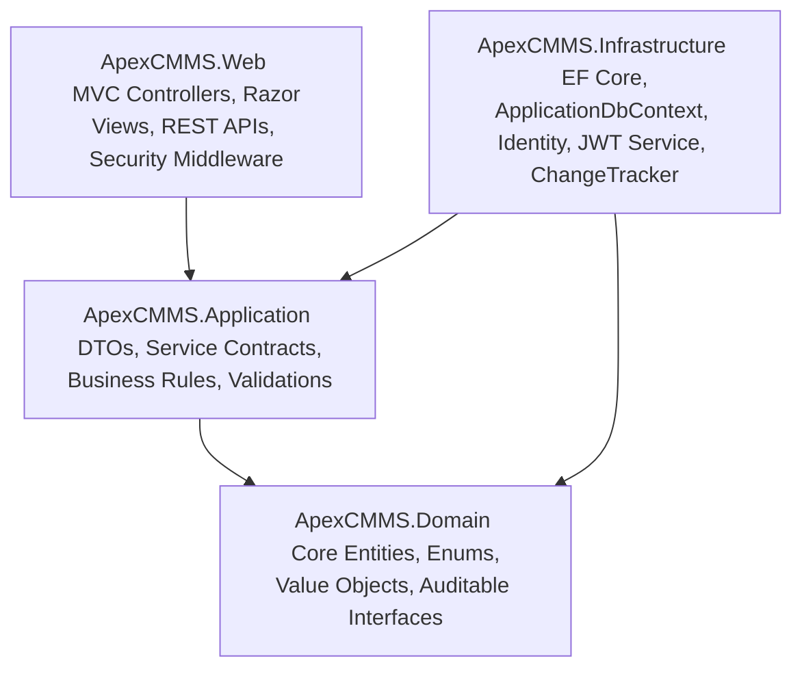
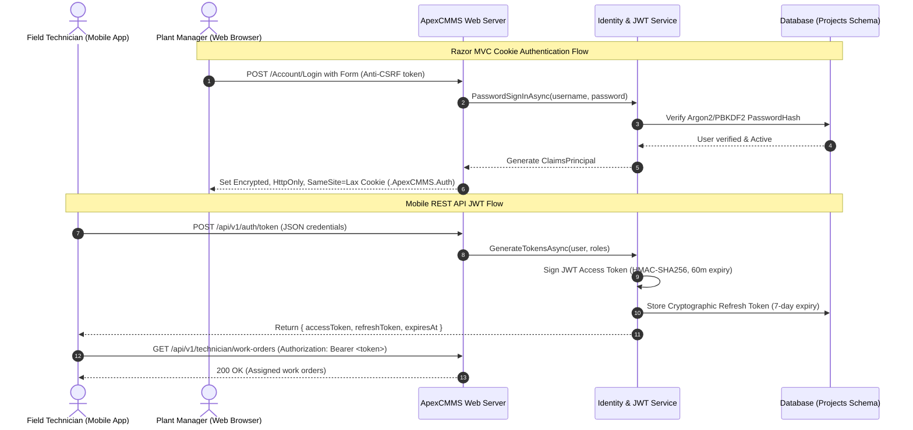
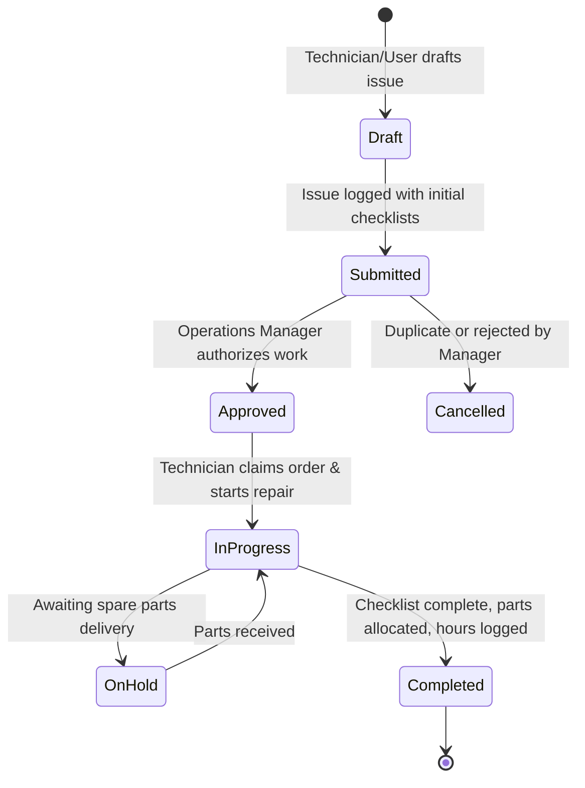
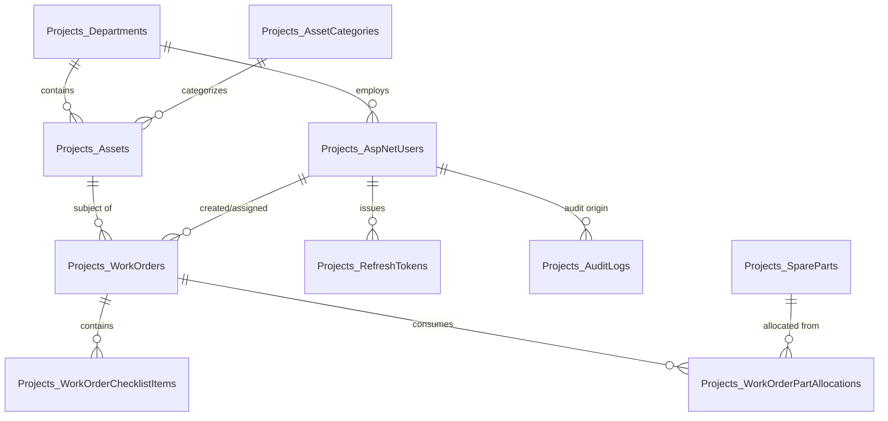

# ApexCMMS: Complete Architectural, Working & Technical Reference Manual

---

## 1. Executive Summary & System Overview

**ApexCMMS** is a mission-critical Enterprise Asset & Maintenance Management System engineered with **ASP.NET Core MVC** and **Clean Architecture**. It models the real-world operational workflows of large industrial facilities, manufacturing plants, utilities, and healthcare networks.

The platform provides end-to-end lifecycle management for high-value machinery and critical infrastructure:
* **Equipment Asset Registry**: Tracking health telemetry, operational status, warranty lifecycles, and failure history.
* **Work Order Dispatching State Machine**: Finite state progression from initial submission, managerial authorization, technician dispatching, to final sign-off.
* **Parts Inventory & Supply Chain**: Real-time stock tracking with atomic deduction, low-stock reorder thresholds, and bin locations.
* **Hybrid Security Engine**: Web UI secured with ASP.NET Core Identity Cookies + Anti-CSRF protection; mobile technician REST endpoints secured with JWT Bearer tokens and Refresh Token Rotation.
* **Granular RBAC & Policy Security**: Role hierarchy (SuperAdmin, OperationsManager, FieldTechnician, SafetyAuditor) enhanced with department-level data isolation.
* **Session & State Handling**: Multi-step inspection wizard with session-backed transient diagnostic state and parts reservation.
* **Automated Audit Logging**: ChangeTracker-driven JSON diff generation (`OldValues` vs `NewValues`) recording every database alteration for ISO/compliance auditing.

---

## 2. Clean Architecture Breakdown

ApexCMMS strictly decouples business domain rules from UI and database infrastructure using the **Clean Architecture** (Onion Architecture) pattern:



### Layer Responsibilities

| Layer | Responsibility | Dependencies |
| :--- | :--- | :--- |
| **`ApexCMMS.Domain`** | Enterprise business models (`Asset`, `WorkOrder`, `SparePart`, `Department`, `AuditLog`, `ApplicationUser`), Enums (`AssetStatus`, `WorkOrderPriority`), and core interfaces (`IAuditableEntity`, `BaseEntity`). | **Zero external dependencies** (Pure C# and Identity models). |
| **`ApexCMMS.Application`** | Data Transfer Objects (DTOs), presentation contracts, and interfaces (`IApplicationDbContext`, `ICurrentUserService`, `IJwtTokenService`). Encapsulates business logic rules. | References `Domain`. |
| **`ApexCMMS.Infrastructure`** | Data persistence via Entity Framework Core, database schema mapping (`Projects` schema), automatic ChangeTracker audit logging, JWT token generation with rotation, and database seeding (`DbInitializer`). | References `Application` and `Domain`. |
| **`ApexCMMS.Web`** | The presentation boundary. Contains Razor MVC Controllers, views, view models, REST API controllers, session configuration, anti-CSRF filters, and security headers middleware. | References `Infrastructure`, `Application`, and `Domain`. |

---

## 3. Hybrid Security & Authentication Engine

Enterprise applications require different authentication mechanisms depending on the client:
1. **Web Browsers (Human Operators)**: plant managers, system admins, and auditors use desktop browsers.
2. **Mobile / Handheld Devices (Field Workers)**: technicians in the field use tablets or mobile applications communicating via JSON REST APIs.

ApexCMMS integrates both into a single unified ASP.NET Core Identity backend.



### Refresh Token Rotation (Replay Attack Defense)
If an access token expires:
1. The client sends `{ accessToken, refreshToken }` to `/api/v1/auth/refresh`.
2. The server verifies that the refresh token exists, is unexpired, and has **not** been used previously (`IsUsed == false`).
3. If valid, the old token is marked `IsUsed = true`, a brand-new token pair is issued, and `ReplacedByToken` tracks the chain.
4. **Replay Detection**: If an attacker attempts to re-use an already-exchanged token, the system flags a compromise and immediately revokes all tokens in that user's token family (`IsRevoked = true`), terminating all active sessions.

---

## 4. Role-Based Access Control (RBAC) & Custom Policies

### The 4 Enterprise System Roles
1. **`SuperAdmin`**:
   * Global system administration, user provisioning, global overrides, and compliance audit trail inspection.
2. **`OperationsManager`**:
   * Approves submitted work orders, manages department assets, assigns technicians, and oversees equipment maintenance schedules.
3. **`FieldTechnician`**:
   * Field execution: claims assigned work orders, checks off diagnostic checklist steps with digital timestamps, and reserves/allocates spare parts from the warehouse.
4. **`SafetyAuditor`**:
   * Independent oversight: read-only access to equipment historical records and complete compliance audit logs.

### Department Isolation Policy (`DepartmentAuthorizationHandler`)
In large organizations, an Operations Manager in *Electrical Maintenance* must not approve work orders or edit equipment belonging to *Mechanical & Hydraulics*.

ApexCMMS implements this via a custom ASP.NET Core `AuthorizationHandler<DepartmentRequirement, Guid?>`:
* When an Operations Manager or Field Technician queries or edits an asset, the handler extracts the `DepartmentId` claim embedded in their auth cookie/token.
* If the resource's `DepartmentId` matches the user's `DepartmentId`, authorization succeeds.
* Users with the `SuperAdmin` or `SafetyAuditor` role bypass department restrictions and receive global facility scope.

---

## 5. Work Order Lifecycle & State Machine

Every maintenance event follows a disciplined state machine to guarantee accountability:



### Automatic Equipment Status Synchronization
* When a work order with **High** or **Emergency** priority is submitted or approved, the target equipment (`Asset.Status`) automatically transitions to **`UnderMaintenance`**.
* When the work order is finalized and marked **`Completed`**, the equipment automatically reverts back to **`Operational`**.

---

## 6. Multi-Step State & Session Handling (Inspection Wizard)

A classic technical challenge in web applications is managing complex, multi-page data entry without polluting the database with partial or orphan records.

ApexCMMS solves this using **Distributed Session Management** with the **Post-Redirect-Get (PRG)** pattern:

```
[User Browser]
      │
      ├── (1) GET /InspectionWizard/Step1  ───> Pulls or initializes InspectionWizardState from Session
      ├── (2) POST /InspectionWizard/Step1 ───> Validates pre-check notes, saves to Session, Redirects to Step 2
      │
      ├── (3) GET /InspectionWizard/Step2  ───> Pre-fills diagnostics from Session
      ├── (4) POST /InspectionWizard/Step2 ───> Validates checklist tasks, updates Session, Redirects to Step 3
      │
      ├── (5) GET /InspectionWizard/Step3  ───> Loads spare parts inventory and session-reserved cart
      ├── (6) POST /InspectionWizard/AddPart ─> Adds part to session cart without committing DB transaction
      │
      └── (7) POST /InspectionWizard/SubmitFinal 
                   │
                   ▼ (Atomic Database Transaction)
              ├── 1. Generate formatted sequential WorkOrderNumber (WO-YYYY-XXXXX)
              ├── 2. Persist WorkOrder record
              ├── 3. Persist all WorkOrderChecklistItems
              ├── 4. Deduct SpareParts inventory & insert WorkOrderPartAllocations
              ├── 5. Clear HttpContext.Session
              └── 6. Flash TempData["SuccessMessage"] & Redirect to Work Order Details
```

---

## 7. Data Integrity: Optimistic Concurrency & Automated Auditing

### Optimistic Concurrency Control
When two supervisors attempt to edit the same equipment or allocate the same spare part simultaneously, last-in wins causes silent data corruption.
* ApexCMMS adds a `byte[] RowVersion` concurrency token to `Asset`, `WorkOrder`, and `SparePart`.
* Configured in EF Core via `.Property(x => x.RowVersion).IsRowVersion()`.
* If a conflict occurs, EF Core throws a `DbUpdateConcurrencyException`. The controller intercepts this, prevents data overwrite, and prompts the operator with a friendly notification that newer data exists.

### Automated Entity ChangeTracker Auditing
Instead of manually writing audit log code in every controller, ApexCMMS overrides `ApplicationDbContext.SaveChangesAsync()`:
1. Prior to committing changes, the EF Core `ChangeTracker` inspects all modified entities (`Asset`, `WorkOrder`, `SparePart`).
2. It detects the entity state (`Added`, `Modified`, `Deleted`).
3. For modified records, it compares original vs current values property-by-property.
4. It serializes both snapshots into JSON diffs (`OldValues` and `NewValues`).
5. An immutable `AuditLog` row is created storing the acting `UserId`, `UserEmail`, `TimestampUtc`, `Action`, and JSON diffs.

---

## 8. Database Architecture: `Projects` Schema & Stored Procedures

All database objects reside in the custom **`Projects`** schema to isolate enterprise CMMS data from system schemas.

### Relational Schema Blueprint



### The 5 Production Stored Procedures
1. **`Projects.sp_CreateWorkOrder`**:
   * Atomically computes the next annual sequential identifier (`WO-2026-01001`), creates the work order record, and logs an initial audit entry within an isolated transaction.
2. **`Projects.sp_ApproveWorkOrder`**:
   * Verifies that the order is in `Submitted` status, updates to `Approved`, records the approving manager, and locks equipment status if priority is Emergency.
3. **`Projects.sp_AllocateSparePart`**:
   * Employs `WITH (UPDLOCK, ROWLOCK)` pessimistic locking to prevent inventory race conditions, verifies stock sufficiency, deducts quantity, and creates the allocation line item.
4. **`Projects.sp_GetAssetMaintenanceSummary`**:
   * Generates a comprehensive analytical summary: total work orders, completed orders, downtime hours, average repair duration, and total spare parts expenditure.
5. **`Projects.sp_RotateRefreshToken`**:
   * Validates refresh token freshness, checks against replay attacks, marks token as used, issues replacement token, and chains the token family.

---

## 9. Quickstart Guide & Test Credentials

### How to Run
```powershell
cd 'D:\Anubhaw\Projects\Structure\ApexCMMS'
dotnet run --project src/ApexCMMS.Web
```

Open your browser at: **`http://localhost:5164`**

### Pre-Configured Test Credentials (1-Click Fill Available on Login)
| Role | Email | Password | Department | Primary Use Case |
| :--- | :--- | :--- | :--- | :--- |
| **SuperAdmin** | `admin@apexcmms.com` | `Admin@123!` | Global | System administration & complete audit log review |
| **Operations Manager** | `manager@apexcmms.com` | `Manager@123!` | Plant Operations | Work order approvals & asset modifications |
| **Field Technician** | `tech@apexcmms.com` | `Tech@123!` | Electrical Maintenance | Checklist completion, inspection wizard, parts checkout |
| **Safety Auditor** | `auditor@apexcmms.com` | `Auditor@123!` | Safety & Compliance | Read-only compliance and ChangeTracker audit inspection |

---

## 10. Resume Bullet Points & Interview Talking Points

You can include this project in your resume with these concrete points:

> **Enterprise Asset & Maintenance Management System (ApexCMMS)**  
> *Tech Stack: ASP.NET Core 10/9 MVC, C#, EF Core, SQL Server, Redis/Distributed Session, Identity, JWT, Clean Architecture*
> - Architected a multi-tier solution adhering to **Clean Architecture** principles separating Domain, Application, Infrastructure, and Presentation layers.
> - Implemented a **hybrid security model**: ASP.NET Core Identity cookie authentication for Razor Web views and HMAC-SHA256 JWT bearer tokens with refresh token rotation for mobile field APIs.
> - Engineered granular **Claims- and Policy-based RBAC** enforcing department-level data isolation across 4 distinct enterprise user roles.
> - Built a stateful **Multi-Step Inspection Wizard** managing transient diagnostic checklists and parts reservation carts via distributed session caching and the PRG pattern.
> - Prevented data race conditions utilizing EF Core **Optimistic Concurrency Control** (`RowVersion`) and built an **automated ChangeTracker audit trail** recording JSON property diffs for every state mutation.
> - Authored transactional **T-SQL Stored Procedures** in a custom `Projects` database schema for high-throughput work order creation, row-locked inventory deduction, and token rotation.
